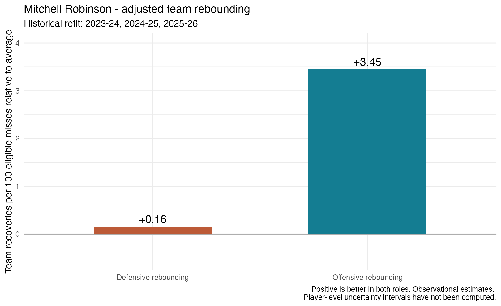
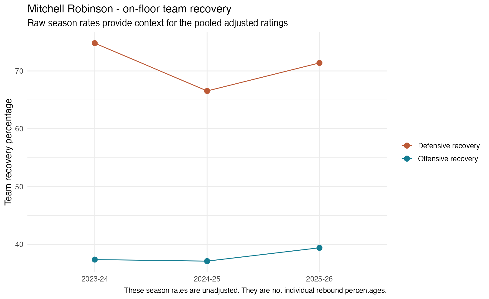

# Mitchell Robinson - rebounding RAPM

These ratings use a league-wide historical refit. They estimate association with team recovery, adjusting for teammates, opponents, missed two versus three, blocked shots, and home offense.

Offensive rebounding: +3.45 team recoveries per 100 eligible misses relative to average, across 2,214 opportunities. Rank 4 of 546 eligible players.

Defensive rebounding: +0.16 team recoveries per 100 eligible misses relative to average, across 2,034 opportunities. Rank 182 of 537 eligible players.

A +2 rating represents an estimated two additional team recoveries per 100 eligible opportunities relative to the modeled average player in that role. This can include boxing out for a teammate.

The model does not identify a causal training effect or a specific skill intervention. Shared minutes and team scheme can affect estimates. Player-level uncertainty intervals have not been computed.

